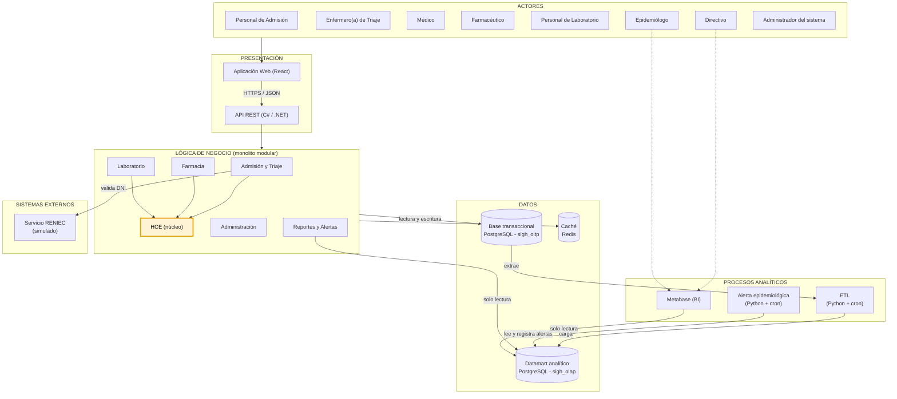

# Arquitectura inicial del sistema

## Diagrama de arquitectura

## Descripción

La arquitectura inicial se organiza en cuatro capas principales, más los procesos analíticos que se ejecutan de forma independiente:

- **Presentación:** permite la interacción de los usuarios con el sistema mediante la aplicación web en React y la API REST en C# / .NET.
- **Lógica de negocio:** un monolito modular que contiene los módulos Admisión y Triaje, HCE, Farmacia, Laboratorio, Administración, y Reportes y Alertas. La **HCE es el núcleo**: Admisión y Triaje, Farmacia y Laboratorio vinculan su información a la historia clínica del paciente.
- **Datos:** la base transaccional (OLTP) guarda la operación clínica diaria, la caché Redis acelera las consultas frecuentes y el datamart (OLAP) guarda la información agregada para el análisis. Las bases OLTP y OLAP están separadas físicamente.
- **Procesos analíticos:** el ETL carga periódicamente los datos de la base transaccional al datamart; el proceso de alerta epidemiológica analiza el datamart para detectar aumentos inusuales de diagnósticos, y Metabase muestra los dashboards. Ninguno de ellos accede a la base transaccional durante el análisis, por lo que no afectan la operación clínica.

Además, el módulo de **Admisión y Triaje** se integra con el **servicio de RENIEC** (simulado en la prueba de concepto) para validar el DNI de los pacientes.

## Componentes por capa

| Capa | Componentes | Tecnología |
|---|---|---|
| Presentación | Aplicación web, API REST | React, ASP.NET Core |
| Lógica de negocio | Admisión y Triaje, HCE, Farmacia, Laboratorio, Administración, Reportes y Alertas | C# / .NET (Clean Architecture por módulo) |
| Datos | Base transaccional, caché, datamart | PostgreSQL (`sigh_oltp`), Redis, PostgreSQL (`sigh_olap`) |
| Procesos analíticos | ETL, alerta epidemiológica, BI | Python + cron, Metabase |
| Sistemas externos | Servicio de identidad | RENIEC (simulado) |