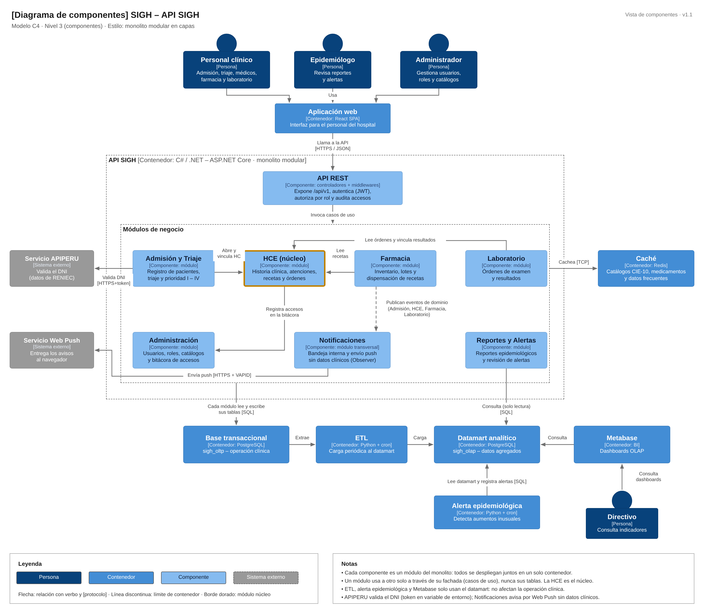

# Componentes arquitectónicos

## Descripción de los componentes

| Componente | Tipo | Responsabilidad | Se relaciona con |
|---|---|---|---|
| **Aplicación web** | Contenedor (React SPA) | Interfaz para el personal del hospital, el epidemiólogo y el administrador. Incluye un Service Worker que recibe las notificaciones push. | API REST [HTTPS / JSON] |
| **API REST** | Componente (ASP.NET Core) | Expone `/api/v1`, autentica con JWT, autoriza por rol, audita accesos e invoca los casos de uso de cada módulo. | Módulos de negocio |
| **Admisión y Triaje** | Componente (módulo) | Registro de pacientes, ingreso a la atención, triaje y clasificación de prioridad I – IV. | HCE, servicio APIPERU, Notificaciones (eventos), base transaccional |
| **HCE (núcleo)** | Componente (módulo) | Historia clínica, atenciones, diagnósticos CIE-10, recetas y órdenes de laboratorio; registros firmados inmutables. | Administración (bitácora), Notificaciones (eventos), base transaccional |
| **Farmacia** | Componente (módulo) | Inventario de medicamentos, lotes, vencimientos y dispensación de recetas. | HCE (lee recetas), Notificaciones (eventos), base transaccional |
| **Laboratorio** | Componente (módulo) | Órdenes de examen y registro de resultados vinculados a la historia clínica. | HCE, Notificaciones (eventos), base transaccional |
| **Administración** | Componente (módulo) | Usuarios, roles, permisos, catálogos y bitácora de accesos a la HCE. | Base transaccional |
| **Reportes y Alertas** | Componente (módulo) | Reportes epidemiológicos y revisión de las alertas generadas. | Datamart (solo lectura) |
| **Notificaciones** | Componente (módulo transversal) | Recibe los eventos de los módulos (Observer), decide a qué roles avisar, guarda la notificación en la bandeja interna y la envía por Web Push en segundo plano, sin datos clínicos. | Módulos de negocio (eventos), alerta epidemiológica (endpoint interno), base transaccional (suscripciones y bandeja), servicio Web Push |
| **Base transaccional** | Contenedor (PostgreSQL – `sigh_oltp`) | Almacena la operación clínica diaria. | Módulos de negocio, ETL |
| **Caché** | Contenedor (Redis) | Guarda catálogos y datos de consulta frecuente. | Módulos de negocio [TCP] |
| **ETL** | Contenedor (Python + cron) | Extrae periódicamente los datos de la base transaccional y los carga en el datamart. | Base transaccional, datamart |
| **Datamart analítico** | Contenedor (PostgreSQL – `sigh_olap`) | Almacena la información agregada para el análisis y las alertas. | ETL, Reportes y Alertas, alerta epidemiológica, Metabase |
| **Alerta epidemiológica** | Contenedor (Python + cron) | Detecta aumentos inusuales de diagnósticos y registra las alertas. | Datamart, Notificaciones (avisa nuevas alertas) |
| **Metabase** | Contenedor (BI) | Dashboards e indicadores OLAP para directivos y epidemiología. | Datamart (solo lectura) |
| **Servicio APIPERU** | Sistema externo | Valida el DNI del paciente y devuelve sus nombres (fuente RENIEC). Requiere un token, guardado como variable de entorno. | Admisión y Triaje [HTTPS / JSON + token] |
| **Servicio Web Push** | Sistema externo (navegador) | Entrega las notificaciones push al navegador o dispositivo del usuario suscrito. | Notificaciones [HTTPS + VAPID] |
