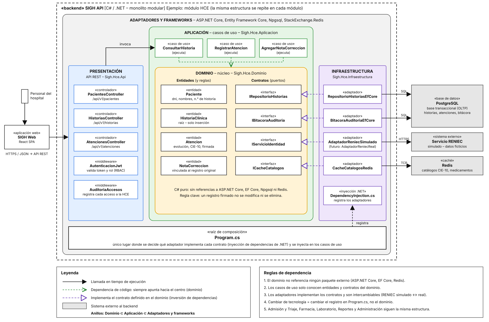

# Enfoque arquitectónico

Se utiliza el enfoque **Clean Architecture** (Arquitectura Limpia) dentro de cada módulo del backend, para separar las reglas del negocio clínico de los detalles tecnológicos. Corresponde a la decisión **ADR-002**.

| Elemento | Descripción aplicada al SIGH |
|---|---|
| Patrón / enfoque arquitectónico | Clean Architecture (Arquitectura Limpia). |
| Objetivo | Separar responsabilidades y controlar que todas las dependencias apunten hacia el dominio clínico. |
| ¿Qué problema resuelve? | Evita el acoplamiento entre la API, las reglas del negocio clínico (por ejemplo, que un registro firmado no se modifica) y las tecnologías externas, como PostgreSQL, Redis o el servicio de RENIEC. |
| Capas definidas | **Dominio**: entidades, reglas y contratos (puertos). **Aplicación**: casos de uso. **Infraestructura**: adaptadores que implementan los contratos (repositorios, caché, RENIEC simulado). **Presentación**: API REST (controladores y middlewares de autenticación y auditoría). |
| Regla de dependencia | El dominio no depende de ninguna otra capa ni de paquetes externos; la aplicación solo depende del dominio; la infraestructura y la presentación dependen hacia adentro. La conexión entre contratos y adaptadores se realiza en la raíz de composición (`Program.cs`) mediante inyección de dependencias. |
| Aplicación en los módulos | Cada módulo del monolito (Admisión y Triaje, HCE, Farmacia, Laboratorio, Reportes Epidemiológicos y Administración) repite esta estructura. |
| Relación con SDD | Cada capa tiene una responsabilidad clara, lo que permite redactar especificaciones precisas por módulo (entidades, casos de uso, contratos de API) a partir de las cuales Claude Code genera el código. |
| Drivers que atiende | DA02 – Seguridad, DA08 – Mantenibilidad, DA09 – RENIEC reemplazable. |
| Beneficios | • Facilita el mantenimiento y las pruebas unitarias de las reglas clínicas sin depender de la base de datos. • Permite reemplazar el servicio de RENIEC simulado por el real modificando solo la infraestructura. • Mejora la organización del código y su generación ordenada mediante SDD. |

