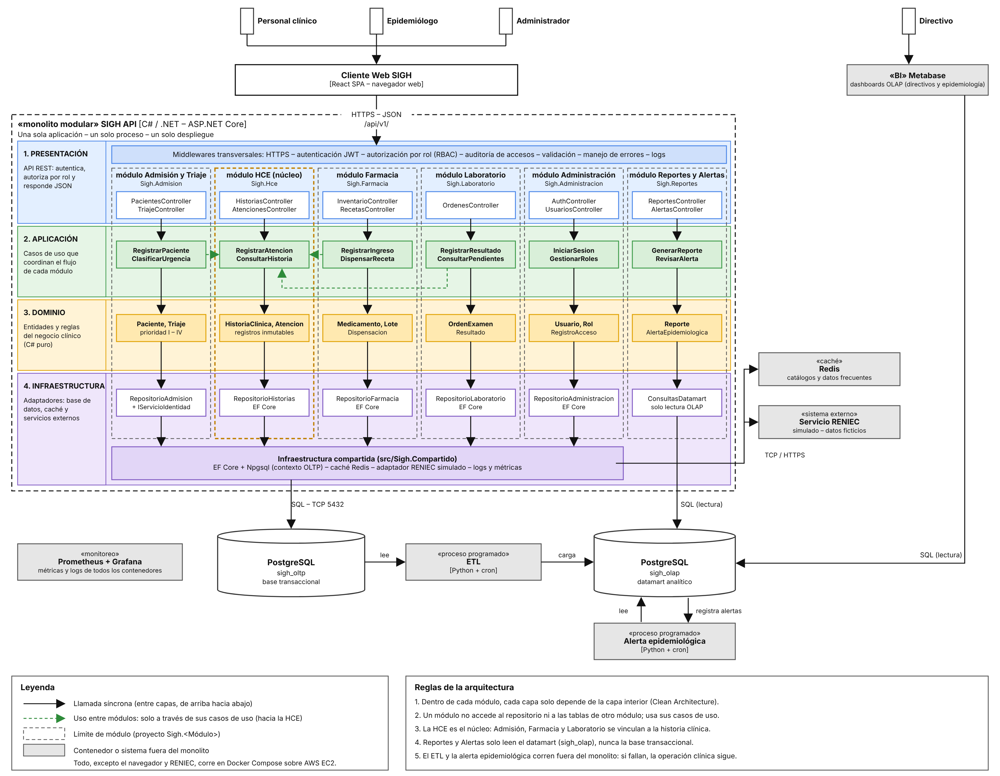

# Estilo arquitectónico

Se utiliza el estilo arquitectónico: **monolito modular + capas**, complementado con procesos analíticos independientes (ETL y alerta epidemiológica). Corresponde a la decisión **ADR-001**.

| Elemento | Descripción aplicada al SIGH |
|---|---|
| Estilo arquitectónico | Monolito modular: una sola aplicación backend (SIGH API, C# / .NET), un solo proceso y un solo despliegue, organizada internamente en módulos independientes. |
| Módulos | Admisión y Triaje, HCE (núcleo), Farmacia, Laboratorio, Administración, y Reportes y Alertas. |
| Capas por módulo | Presentación (API REST), Aplicación (casos de uso), Dominio (entidades y reglas) e Infraestructura (adaptadores), según el enfoque Clean Architecture. |
| Comunicación entre módulos | Solo a través de los casos de uso del módulo destino; ningún módulo accede al repositorio ni a las tablas de otro. Admisión, Farmacia y Laboratorio se vinculan a la HCE. |
| Componentes fuera del monolito | Base transaccional PostgreSQL (`sigh_oltp`), datamart PostgreSQL (`sigh_olap`), proceso ETL (Python + cron), proceso de alerta epidemiológica (Python + cron), Metabase, Redis, monitoreo con Prometheus + Grafana y el servicio RENIEC simulado. |
| Despliegue | Todos los componentes, excepto el navegador y RENIEC, se ejecutan como contenedores con Docker Compose sobre AWS EC2 (ADR-010). |
| ¿Por qué no microservicios? | Para una sola persona y un presupuesto bajo (DA04), operar muchos servicios independientes no es viable. Como los módulos tienen límites claros, podrían extraerse como microservicios en el futuro sin rediseñar la lógica. |
| Drivers que atiende | DA01 – HCE como núcleo, DA03 – Aislamiento OLTP / OLAP, DA04 – Desarrollo individual y bajo costo, DA08 – Mantenibilidad. |

