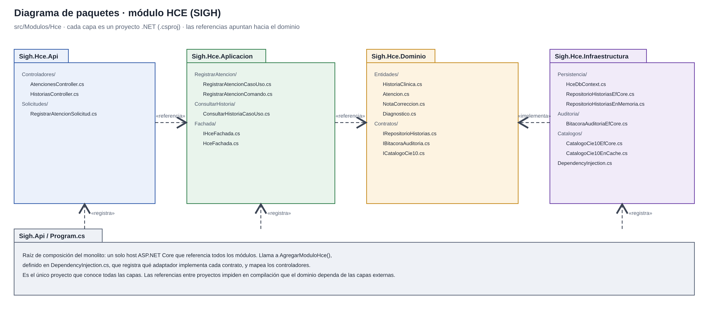
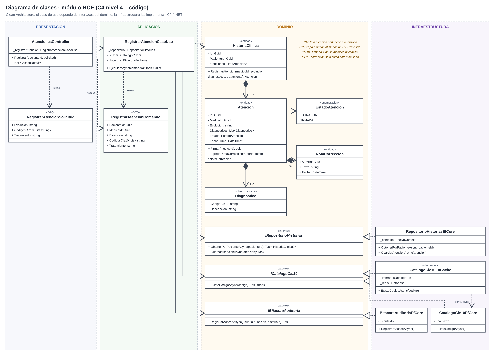
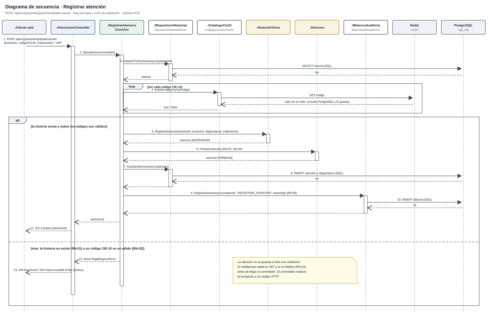

# Diseño interno de módulos

> **Proyecto:** SIGH · **Backend:** C# / .NET – ASP.NET Core · **Módulo de referencia:** HCE  
> **Enfoque arquitectónico:** Clean Architecture dentro de cada módulo del monolito modular  
> **Nivel C4:** 4 – Código · **Versión:** 1.0

---

## 1. Propósito

Este documento describe **cómo se organiza el código dentro de un módulo** del backend. Tiene cuatro objetivos:

- que todos los módulos (Admisión y Triaje, HCE, Farmacia, Laboratorio, Administración, y Reportes y Alertas) se construyan con la misma estructura;
- que las reglas del negocio clínico queden aisladas de la tecnología;
- que se sepa dónde va cada archivo y de qué puede depender;
- que sirva como base para redactar las especificaciones SDD de cada módulo, a partir de las cuales Claude Code genera el código.

## 2. Estructura de carpetas

```text
src/
├── Sigh.Api/                                  Host único del monolito (ASP.NET Core)
│   ├── Program.cs                             Raíz de composición
│   └── appsettings.json                       Configuración (cadenas de conexión, JWT)
├── Compartido/
│   └── Sigh.Compartido/                       Errores de negocio, utilidades comunes
└── Modulos/
    └── Hce/
        ├── Sigh.Hce.Dominio/
        │   ├── Entidades/
        │   │   ├── HistoriaClinica.cs         Raíz: agrupa las atenciones del paciente
        │   │   ├── Atencion.cs                Entidad Atencion y sus reglas
        │   │   ├── NotaCorreccion.cs          Corrección vinculada a una atención firmada
        │   │   └── Diagnostico.cs             Objeto de valor: código CIE-10 y descripción
        │   └── Contratos/
        │       ├── IRepositorioHistorias.cs   Interfaz (puerto) de persistencia
        │       ├── IBitacoraAuditoria.cs      Interfaz (puerto) de auditoría
        │       └── ICatalogoCie10.cs          Interfaz (puerto) de validación CIE-10
        ├── Sigh.Hce.Aplicacion/
        │   ├── RegistrarAtencion/
        │   │   ├── RegistrarAtencionCasoUso.cs    Caso de uso RegistrarAtencion
        │   │   └── RegistrarAtencionComando.cs    Datos de entrada del caso de uso
        │   ├── ConsultarHistoria/
        │   │   └── ConsultarHistoriaCasoUso.cs    Caso de uso ConsultarHistoria
        │   └── Fachada/
        │       ├── IHceFachada.cs             API pública del módulo para otros módulos
        │       └── HceFachada.cs              Implementación de la fachada
        ├── Sigh.Hce.Infraestructura/
        │   ├── Persistencia/
        │   │   ├── HceDbContext.cs            Contexto de EF Core (esquema hce)
        │   │   ├── RepositorioHistoriasEfCore.cs      Implementación con PostgreSQL
        │   │   └── RepositorioHistoriasEnMemoria.cs   Implementación para pruebas
        │   ├── Auditoria/
        │   │   └── BitacoraAuditoriaEfCore.cs Registro de accesos en PostgreSQL
        │   ├── Catalogos/
        │   │   ├── CatalogoCie10EfCore.cs     Consulta del catálogo en PostgreSQL
        │   │   └── CatalogoCie10EnCache.cs    Decorador con Redis
        │   └── DependencyInjection.cs         Registro de los adaptadores del módulo
        └── Sigh.Hce.Api/
            ├── Controladores/
            │   ├── AtencionesController.cs    Traduce HTTP ⇄ caso de uso
            │   └── HistoriasController.cs     Consulta de historias clínicas
            └── Solicitudes/
                └── RegistrarAtencionSolicitud.cs  Cuerpo de la petición HTTP
```

| Archivo | Capa | Responsabilidad | Referencia a |
|---|---|---|---|
| `HistoriaClinica.cs` | Dominio | Agrupar las atenciones de un paciente y garantizar que pertenezcan a él | Solo dominio |
| `Atencion.cs` | Dominio | Registrar evolución y diagnósticos, firmar y aplicar la regla de inmutabilidad | Solo dominio |
| `NotaCorreccion.cs` | Dominio | Representar una corrección con autor y fecha, sin alterar el original | Nada |
| `Diagnostico.cs` | Dominio | Representar un diagnóstico con su código CIE-10 | Nada |
| `IRepositorioHistorias.cs` | Dominio | Declarar **qué** operaciones de persistencia necesita el módulo | Entidades |
| `IBitacoraAuditoria.cs` | Dominio | Declarar **qué** necesita el módulo para registrar accesos | Nada |
| `ICatalogoCie10.cs` | Dominio | Declarar **qué** necesita el módulo para validar diagnósticos | Nada |
| `RegistrarAtencionCasoUso.cs` | Aplicación | Coordinar los pasos del registro de una atención | Dominio |
| `RegistrarAtencionComando.cs` | Aplicación | Datos de entrada validados del caso de uso | Nada |
| `IHceFachada.cs` / `HceFachada.cs` | Aplicación | Exponer solo lo que otros módulos pueden usar (recetas, órdenes, vínculo de resultados) | Dominio |
| `HceDbContext.cs` | Infraestructura | Mapear las entidades a tablas de PostgreSQL con EF Core | Dominio + EF Core |
| `RepositorioHistoriasEfCore.cs` | Infraestructura | Guardar y leer historias y atenciones en PostgreSQL | Dominio + EF Core |
| `RepositorioHistoriasEnMemoria.cs` | Infraestructura | Implementación en memoria para pruebas unitarias | Dominio |
| `BitacoraAuditoriaEfCore.cs` | Infraestructura | Registrar usuario, fecha, hora y acción de cada acceso | Dominio + EF Core |
| `CatalogoCie10EfCore.cs` | Infraestructura | Consultar códigos CIE-10 en PostgreSQL | Dominio + EF Core |
| `CatalogoCie10EnCache.cs` | Infraestructura | Consultar primero en Redis y luego en PostgreSQL (Decorator) | Dominio + StackExchange.Redis |
| `DependencyInjection.cs` | Infraestructura | Registrar qué adaptador implementa cada contrato (`AgregarModuloHce()`) | Todas las capas del módulo |
| `AtencionesController.cs` | Presentación | Leer la petición HTTP, invocar el caso de uso y responder | Aplicación |
| `RegistrarAtencionSolicitud.cs` | Presentación | Estructura del cuerpo JSON de la petición | Nada |
| `Program.cs` | Composición | Configurar el host, JWT, autorización y registrar todos los módulos | Todos los proyectos |

---

## 3. Capas del módulo y regla de dependencia



**Regla de dependencia:** el código solo puede referenciar hacia el centro (dominio). El dominio no conoce ASP.NET Core, EF Core, PostgreSQL ni Redis. En .NET esta regla se refuerza con las **referencias entre proyectos**: `Sigh.Hce.Dominio` no referencia ningún otro proyecto, por lo que si se intenta usar EF Core en el dominio, el código no compila.

| Capa | Contiene | Responsabilidad | Puede depender de | **No** puede depender de |
|---|---|---|---|---|
| **Dominio** | Entidades, objetos de valor, interfaces (puertos) | Reglas del negocio clínico que serían ciertas con cualquier tecnología | Nada externo | Aplicación, infraestructura, presentación, ASP.NET Core, EF Core, Redis |
| **Aplicación** | Casos de uso, comandos, fachada del módulo | Orquestar el flujo: qué paso va primero y qué hacer si falla | Dominio | Infraestructura, presentación, ASP.NET Core, EF Core |
| **Infraestructura** | Repositorios, adaptadores, contexto de EF Core | Implementar las interfaces del dominio con una tecnología | Dominio, librerías externas | Presentación |
| **Presentación** | Controladores, solicitudes | Traducir HTTP a llamadas del caso de uso y viceversa | Aplicación | Infraestructura, base de datos |
| **Composición** | `Program.cs`, `DependencyInjection.cs` | Elegir implementaciones concretas y conectarlas | Todas | — |

> **Cómo comprobarlo en el código:** basta revisar el archivo `Sigh.Hce.Dominio.csproj`. Si aparece una referencia a `Microsoft.EntityFrameworkCore`, `Npgsql`, `StackExchange.Redis` o a otro proyecto del sistema, la regla se rompió.

### 3.1 Reglas de negocio del módulo HCE

| ID | Regla de negocio | Dónde se aplica |
|---|---|---|
| RN-01 | Toda atención debe pertenecer a una historia clínica existente. | `HistoriaClinica` |
| RN-02 | Una atención solo puede firmarse si tiene al menos un diagnóstico con un código CIE-10 válido. | `Atencion`, `ICatalogoCie10` |
| RN-03 | Solo un usuario con rol Médico puede registrar y firmar una atención. | Middleware de autorización, `Atencion` |
| RN-04 | Una atención firmada no se modifica ni se elimina. | `Atencion` |
| RN-05 | Las correcciones se registran como una nota vinculada a la atención original, con autor y fecha. | `Atencion`, `NotaCorreccion` |
| RN-06 | Todo acceso o modificación a una historia clínica se registra en la bitácora de auditoría. | `IBitacoraAuditoria` |
---

## 4. Diagrama de clases



### 4.1 Notación UML utilizada

| Símbolo | Significado | Ejemplo en el diagrama |
|---|---|---|
| Línea continua con flecha abierta | Asociación: la clase guarda una referencia a la otra | `RegistrarAtencionCasoUso` → `IRepositorioHistorias` |
| Línea discontinua con flecha abierta | Dependencia: la usa o la crea, pero no la guarda | `AtencionesController` «crea» `RegistrarAtencionComando` |
| Línea discontinua con triángulo hueco | Realización: implementa una interfaz | `RepositorioHistoriasEfCore` ▷ `IRepositorioHistorias` |
| Rombo relleno | Composición: la parte no existe sin el todo | `HistoriaClinica` ◆ `Atencion` (0..*), `Atencion` ◆ `Diagnostico` (1..*) |
| Nombre en cursiva + «interfaz» | Interfaz (contrato sin implementación) | `IRepositorioHistorias`, `ICatalogoCie10` |
| «decorador» | Clase que envuelve a otra implementación de la misma interfaz | `CatalogoCie10EnCache` «envuelve» `CatalogoCie10EfCore` |
| `-` / `+` | Privado / público | `- Estado`, `+ Firmar(medicoId)` |

---

## 5. Flujo de ejecución: registrar atención



| Paso | Origen → destino | Acción | Capa |
|---|---|---|---|
| 1 | Cliente web → `AtencionesController` | `POST /api/v1/pacientes/{id}/atenciones` con `evolucion`, `codigosCie10`, `tratamiento` y el token JWT; el middleware valida el rol Médico (RN-03) | Presentación |
| 2 | `AtencionesController` → `RegistrarAtencionCasoUso` | `EjecutarAsync(comando)`; el `medicoId` se toma del token, no del cuerpo de la petición | Presentación → Aplicación |
| 3 | `RegistrarAtencionCasoUso` → `IRepositorioHistorias` | `ObtenerPorPacienteAsync(pacienteId)`; consulta la historia en PostgreSQL (RN-01) | Aplicación → Dominio (interfaz) |
| 4 | `RegistrarAtencionCasoUso` → `ICatalogoCie10` | `ExisteCodigoAsync(codigo)` por cada diagnóstico; busca primero en Redis y, si no está, en PostgreSQL (RN-02) | Aplicación → Dominio (interfaz) |
| 5 | `RegistrarAtencionCasoUso` → `HistoriaClinica` | `RegistrarAtencion(...)`; se crea la atención en estado BORRADOR | Aplicación → Dominio |
| 6 | `RegistrarAtencionCasoUso` → `Atencion` | `Firmar(medicoId)`; pasa a estado FIRMADA y ya no puede modificarse (RN-02, RN-04) | Aplicación → Dominio |
| 7–8 | `RegistrarAtencionCasoUso` → `IRepositorioHistorias` → PostgreSQL | `GuardarAtencionAsync(atencion)`; `INSERT` de la atención y sus diagnósticos | Aplicación → Infraestructura → BD |
| 9–10 | `RegistrarAtencionCasoUso` → `IBitacoraAuditoria` → PostgreSQL | `RegistrarAccesoAsync(...)`; se registra quién, cuándo y qué acción realizó (RN-06) | Aplicación → Infraestructura → BD |
| 11 | `AtencionesController` → Cliente web | `201 Created` con `atencionId` | Presentación |
| 12–13 | Alternativa | Si la historia no existe (RN-01) o un código CIE-10 no es válido (RN-02): no se guarda la atención y se responde `404` o `422` | Aplicación → Presentación |