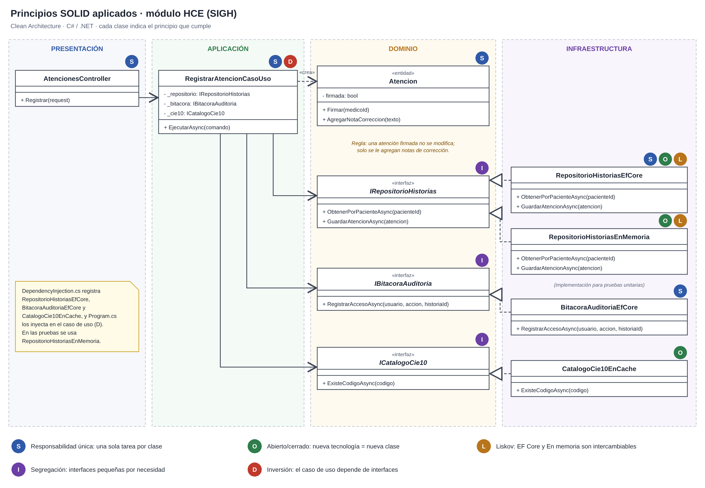

# Principios de diseño (SOLID)

## Objetivo

Documentar cómo se aplican los principios SOLID en el backend del SIGH, organizado con Clean Architecture, para que cada módulo se especifique y se genere con SDD de forma uniforme, y para que las reglas del negocio clínico no dependan de la tecnología.

## Contexto

- **Estilo:** monolito modular (C# / .NET – ASP.NET Core).
- **Enfoque interno:** Clean Architecture (presentación, aplicación, dominio, infraestructura).
- **Módulo de referencia:** HCE, porque es el núcleo del sistema e integra la base de datos, la bitácora de auditoría y el catálogo CIE-10.
- **Caso de uso de referencia:** registrar una atención médica (`RegistrarAtencionCasoUso`).

## SOLID en el módulo HCE

| Principio | Dónde se aplica (capa) | Cómo se cumple en el SIGH | Archivos |
|---|---|---|---|
| **S** · Responsabilidad única | Todas las capas | Cada clase tiene una sola tarea: el controlador recibe la petición HTTP, el caso de uso coordina el registro de la atención, la entidad `Atencion` aplica las reglas clínicas (una atención firmada no se modifica) y el repositorio guarda en PostgreSQL. | `AtencionesController.cs`, `RegistrarAtencionCasoUso.cs`, `Atencion.cs`, `RepositorioHistoriasEfCore.cs` |
| **O** · Abierto/cerrado | Infraestructura | Para cambiar la forma de guardar o consultar datos se crea un nuevo adaptador (por ejemplo, un repositorio en memoria para pruebas o el adaptador real de RENIEC); el caso de uso no se modifica. | `RepositorioHistoriasEfCore.cs`, `RepositorioHistoriasEnMemoria.cs`, `AdaptadorReniecSimulado.cs` |
| **L** · Sustitución de Liskov | Infraestructura | `RepositorioHistoriasEfCore` y `RepositorioHistoriasEnMemoria` cumplen el mismo contrato y devuelven los mismos resultados; el caso de uso funciona igual con cualquiera. Lo mismo ocurre con `AdaptadorReniecSimulado` y el futuro `AdaptadorReniecReal`. | `RepositorioHistoriasEfCore.cs`, `RepositorioHistoriasEnMemoria.cs` |
| **I** · Segregación de interfaces | Dominio | Cada interfaz tiene solo lo que la HCE necesita: `IRepositorioHistorias` solo guarda y consulta historias, `IBitacoraAuditoria` solo registra accesos e `ICatalogoCie10` solo valida códigos de diagnóstico. | `IRepositorioHistorias.cs`, `IBitacoraAuditoria.cs`, `ICatalogoCie10.cs` |
| **D** · Inversión de dependencias | Aplicación | El caso de uso recibe interfaces por el constructor y no conoce PostgreSQL, EF Core ni Redis; las implementaciones se registran en `DependencyInjection.cs` y se inyectan desde `Program.cs`. | `RegistrarAtencionCasoUso.cs`, `DependencyInjection.cs`, `Program.cs` |

## Qué pasaría sin SOLID en el SIGH

| Situación real | Sin SOLID | Con SOLID |
|---|---|---|
| Se obtiene el convenio con RENIEC | Hay que modificar el caso de uso de registro de pacientes | Solo se crea `AdaptadorReniecReal` y se registra en lugar del simulado |
| Se quiere probar el registro de atenciones | Se necesita PostgreSQL y Redis funcionando | Se prueba con `RepositorioHistoriasEnMemoria` |
| Cambia una regla clínica (por ejemplo, quién puede firmar) | Hay que buscarla en controladores, servicios y consultas SQL | Está solo en la entidad `Atencion` |
| Se cambia la caché de Redis por otra tecnología | Se modifica el código de los módulos clínicos | Solo se reemplaza `CatalogoCie10EnCache` |
| Se agrega un nuevo requisito de auditoría | Se modifican varios módulos | Solo cambia la implementación de `IBitacoraAuditoria` |

## Relación con Clean Architecture y los patrones

| Principio | Lo cumple en el proyecto |
|---|---|
| Responsabilidad única | La separación en capas de Clean Architecture |
| Abierto/cerrado y Liskov | El patrón Adapter (servicio RENIEC) y los repositorios intercambiables |
| Segregación de interfaces | Los contratos del dominio (`IRepositorioHistorias`, `IBitacoraAuditoria`, `ICatalogoCie10`, `IServicioIdentidad`) |
| Inversión de dependencias | El patrón Repository, la inyección de dependencias de .NET y la regla de dependencia: las capas externas dependen del dominio |