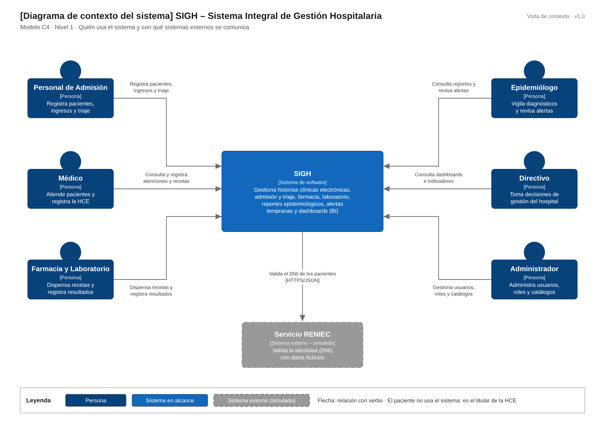

# Nivel 1 · Diagrama de contexto del sistema

> **Proyecto:** SIGH – Sistema Integral de Gestión Hospitalaria  
> **Modelo:** C4 · Nivel 1 de 4 · **Versión:** 1.0

---

## 1. Objetivo

Mostrar el **SIGH como una sola caja**: quiénes lo usan y con qué sistemas externos se comunica. Es la vista de mayor nivel y la primera que se presenta a cualquier persona, técnica o no.

| Aspecto | Descripción |
|---|---|
| Pregunta que responde | ¿Qué es el sistema, quién lo usa y con quién se integra? |
| Audiencia | Todos: personal del hospital, docente, desarrollo y operaciones |
| Qué **no** muestra | Tecnologías, servidores, bases de datos ni módulos internos |
| Siguiente nivel | `Nivel2-DiagramadeContenedores.md` |

---

## 2. Diagrama

> Archivo editable: `img/fuentes-svg/nivel1-contexto.drawio`

---

## 3. Personas (usuarios)

| Persona | Descripción | Qué hace en el sistema |
|---|---|---|
| **Personal de Admisión** | Personal de admisión y enfermería de triaje | Registra pacientes validando su DNI, registra ingresos, toma signos vitales y clasifica la prioridad de atención |
| **Médico** | Profesional que atiende al paciente | Consulta la historia clínica, registra atenciones con diagnósticos CIE-10, emite recetas y solicita exámenes |
| **Farmacia y Laboratorio** | Farmacéuticos y personal de laboratorio | Gestiona el inventario, dispensa recetas, recibe órdenes de examen y registra resultados |
| **Epidemiólogo** | Responsable de la vigilancia epidemiológica | Genera reportes por diagnóstico, zona y periodo, y revisa las alertas epidemiológicas tempranas |
| **Directivo** | Responsable de la gestión del hospital | Consulta dashboards e indicadores para la toma de decisiones |
| **Administrador** | Responsable de la operación del sistema | Gestiona usuarios, roles, permisos y catálogos, y consulta la bitácora de accesos |

> El **paciente** no usa el sistema directamente: es el titular de la historia clínica y la información la registran los demás actores.

---

## 4. Sistemas

| Sistema | Tipo | Responsabilidad | Quién lo construye |
|---|---|---|---|
| **SIGH** | Sistema en alcance | Gestiona las historias clínicas electrónicas y la atención del paciente, y ofrece análisis epidemiológico y de gestión | El autor del proyecto |
| **Servicio RENIEC** | Sistema externo (simulado) | Valida la identidad de los pacientes a partir de su DNI | RENIEC; en la prueba de concepto se usa un servicio simulado |

---

## 5. Relaciones

| Origen | Destino | Descripción | Protocolo |
|---|---|---|---|
| Personal de Admisión | SIGH | Registra pacientes, ingresos y triaje | — |
| Médico | SIGH | Consulta y registra atenciones, recetas y órdenes de examen | — |
| Farmacia y Laboratorio | SIGH | Dispensa recetas y registra resultados de laboratorio | — |
| Epidemiólogo | SIGH | Consulta reportes y revisa alertas | — |
| Directivo | SIGH | Consulta dashboards e indicadores | — |
| Administrador | SIGH | Gestiona usuarios, roles y catálogos | — |
| SIGH | Servicio RENIEC | Valida el DNI de los pacientes | HTTPS/JSON |

> En el nivel 1 no se indica el protocolo entre personas y sistema: eso se detalla en el nivel 2.

---

## 6. Decisiones y supuestos

| # | Decisión o supuesto | Motivo |
|---|---|---|
| 1 | La integración con RENIEC se simula en la prueba de concepto | La consulta real requiere un convenio institucional (RC13); el servicio simulado tiene la misma interfaz (ADR-009) |
| 2 | Si RENIEC no responde, el paciente se registra manualmente | Un hospital no puede negar la atención por la falla de un servicio externo (RF02) |
| 3 | Solo se usan datos ficticios de pacientes | Los datos de salud son sensibles según la Ley N° 29733 (RC14, RC15) |
| 4 | El SIGH no se integra con el RENHICE en esta versión | La prueba de concepto respeta sus principios, pero la integración está fuera del alcance (RC16) |

### Pendientes por definir

| Tema | Detalle |
|---|---|
| Notificación epidemiológica al MINSA | Evaluar si las alertas confirmadas deben enviarse a un sistema de vigilancia externo. Si se define, se agregará como sistema externo |
| Integración real con RENIEC | Depende de un convenio institucional; cuando exista, solo se reemplaza el adaptador simulado |