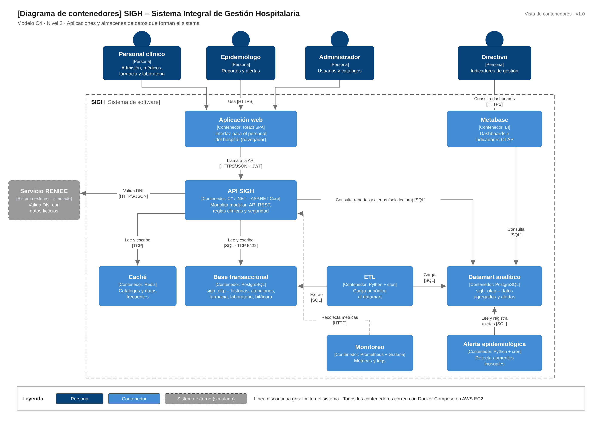

# Nivel 2 · Diagrama de contenedores

> **Proyecto:** SIGH – Sistema Integral de Gestión Hospitalaria  
> **Modelo:** C4 · Nivel 2 de 4 · **Versión:** 1.0

---

## 1. Objetivo

Abrir la caja «SIGH» del nivel 1 y mostrar los **contenedores** que la forman: las aplicaciones, procesos y almacenes de datos que se ejecutan por separado, la tecnología de cada uno y cómo se comunican.

| Aspecto | Descripción |
|---|---|
| Pregunta que responde | ¿De qué piezas ejecutables se compone el sistema y con qué tecnología? |
| Audiencia | Arquitectura, desarrollo y operaciones |
| Qué es un contenedor | Algo que se ejecuta o almacena datos de forma independiente: una aplicación web, una API, una base de datos o un proceso programado (no es lo mismo que un contenedor Docker, aunque en el SIGH cada uno se despliega en su propio contenedor Docker) |
| Nivel anterior | `Nivel1-DiagramadeContextodelSistema.md` |
| Siguiente nivel | `Nivel3-Diagrama-de-Componentes.md` |

---

## 2. Diagrama

> Archivo editable: `img/fuentes-svg/nivel2-contenedores.drawio`

---

## 3. Contenedores

| Contenedor | Tecnología | Responsabilidad | Datos que maneja |
|---|---|---|---|
| **Aplicación web** | SPA · React | Interfaz para el personal clínico, el epidemiólogo y el administrador. Se ejecuta en el navegador | Ninguno persistente; solo el estado de la pantalla y el token de sesión |
| **API SIGH** | C# / .NET – ASP.NET Core | Expone la API REST, aplica las reglas clínicas, la autenticación JWT, la autorización por rol y la auditoría. Es un **monolito modular**: un solo proceso con los módulos Admisión y Triaje, HCE, Farmacia, Laboratorio, Administración, y Reportes y Alertas | Ninguno propio; usa la base transaccional, la caché y el datamart |
| **Base transaccional** | PostgreSQL (`sigh_oltp`) | Almacena de forma permanente la operación clínica diaria | Pacientes, historias clínicas, atenciones, recetas, inventario, exámenes, usuarios y bitácora de accesos |
| **Caché** | Redis | Guarda en memoria los catálogos y datos más consultados para responder más rápido | Copia temporal de catálogos CIE-10, medicamentos y exámenes |
| **ETL** | Python + cron | Extrae periódicamente los datos de la base transaccional, los transforma y los carga en el datamart | Ninguno propio; datos en tránsito |
| **Datamart analítico** | PostgreSQL (`sigh_olap`) | Almacena la información agregada para el análisis, separada físicamente de la operación clínica | Hechos y dimensiones (diagnóstico, zona, periodo) y alertas epidemiológicas |
| **Alerta epidemiológica** | Python + cron | Analiza el datamart para detectar aumentos inusuales de diagnósticos y registra las alertas | Ninguno propio; lee y escribe en el datamart |
| **Metabase** | Metabase (BI) | Muestra dashboards e indicadores para directivos y epidemiología | Ninguno propio; consulta el datamart |
| **Monitoreo** | Prometheus + Grafana | Recolecta métricas y logs de los contenedores para detectar fallas | Métricas y logs técnicos |

---

## 4. Relaciones

| Origen | Destino | Descripción | Protocolo |
|---|---|---|---|
| Personal clínico, Epidemiólogo, Administrador | Aplicación web | Usan la aplicación desde el navegador | HTTPS |
| Directivo (y Epidemiólogo) | Metabase | Consultan dashboards e indicadores | HTTPS |
| Aplicación web | API SIGH | Llama a la API con el token JWT | HTTPS/JSON |
| API SIGH | Base transaccional | Lee y escribe la información clínica | SQL sobre TCP (5432) |
| API SIGH | Caché | Lee y escribe catálogos en memoria | TCP |
| API SIGH | Datamart analítico | Consulta reportes y alertas (solo lectura) | SQL sobre TCP |
| API SIGH | Servicio RENIEC | Valida el DNI de los pacientes | HTTPS/JSON |
| ETL | Base transaccional | Extrae los datos del periodo | SQL sobre TCP |
| ETL | Datamart analítico | Carga los datos transformados | SQL sobre TCP |
| Alerta epidemiológica | Datamart analítico | Lee los datos agregados y registra las alertas | SQL sobre TCP |
| Metabase | Datamart analítico | Consulta los datos para los dashboards | SQL sobre TCP |
| Monitoreo | API SIGH y demás contenedores | Recolecta métricas | HTTP |

---

## 5. Decisiones arquitectónicas reflejadas

| Decisión | Alternativa descartada | Motivo |
|---|---|---|
| Un único contenedor de backend (monolito modular) | Microservicios | Desarrollo individual y bajo presupuesto; los módulos permiten separar servicios en el futuro (ADR-001) |
| Frontend separado del backend (SPA en React + API REST) | Páginas generadas en el servidor | El frontend y el backend evolucionan y se despliegan de forma independiente (ADR-003) |
| Base transaccional y datamart separados | Ejecutar reportes sobre la base transaccional | Las cargas analíticas no deben afectar la operación clínica (ADR-004, AC05) |
| Alerta epidemiológica como proceso independiente | Implementarla dentro de la API | Si falla o se desactiva, la operación clínica no se afecta (ADR-005) |
| Redis como caché de catálogos | Consultar siempre la base de datos | Los catálogos se consultan en casi todas las operaciones clínicas (ADR-006) |
| Metabase como herramienta de BI | Power BI o Apache Superset | Gratuito, liviano y fácil de configurar para una sola persona (ADR-011) |
| Solo la API se comunica con RENIEC | Llamar a RENIEC desde el navegador | Las credenciales del servicio quedan en el servidor y no se exponen al cliente |

---

## 6. Seguridad entre contenedores

| Comunicación | Medida |
|---|---|
| Navegador → Aplicación web, API y Metabase | Tráfico cifrado con HTTPS (TLS obligatorio) |
| Aplicación web → API | Autenticación con token JWT en cada petición y autorización por rol |
| API → Base transaccional, caché y datamart | Acceso solo desde la red interna de Docker; credenciales en variables de entorno |
| Metabase y procesos analíticos → Datamart | Usuario de base de datos con permisos limitados al datamart; sin acceso a la base transaccional, excepto el ETL en modo lectura |
| API → Servicio RENIEC | Credenciales guardadas solo en el servidor |
| Acceso externo a la instancia EC2 | AWS WAF en capa básica, Security Groups y Fail2ban como IDS ligero |

---