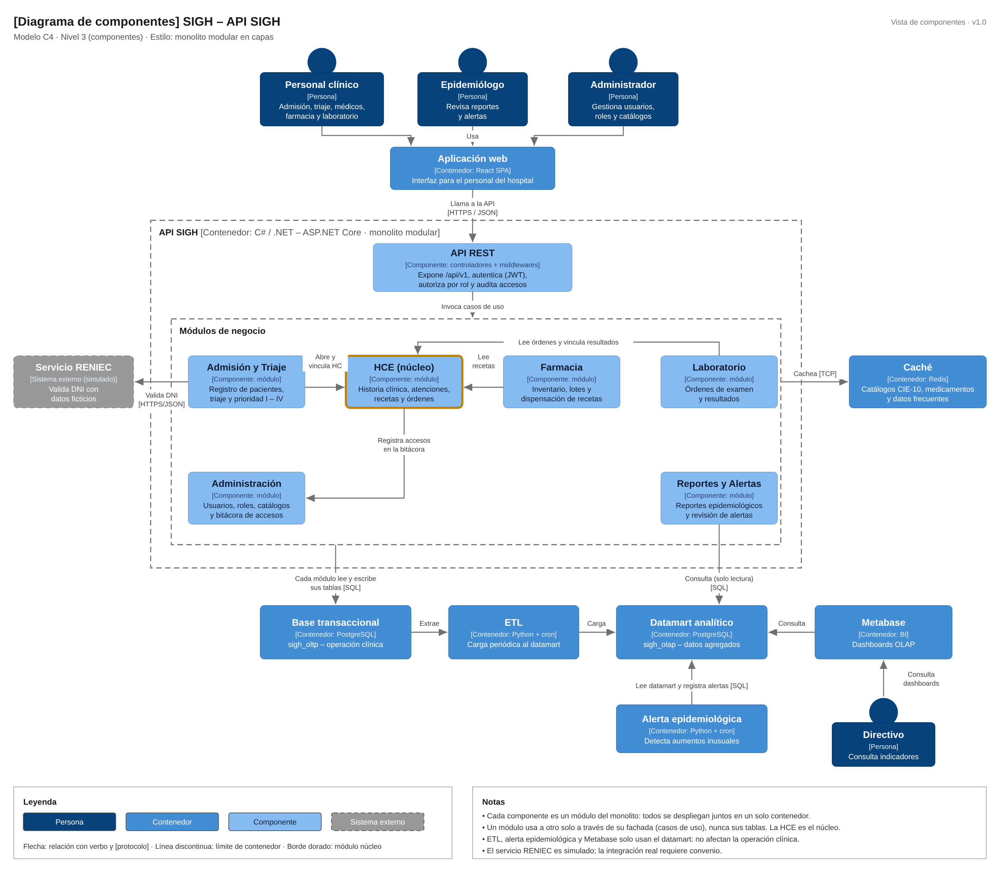

# Nivel 3 · Diagrama de componentes

> **Proyecto:** SIGH · **Contenedor detallado:** API SIGH  
> **Modelo:** C4 · Nivel 3 de 4 · **Versión:** 1.0

---

## 1. Objetivo

Abrir el contenedor **API SIGH** del nivel 2 y mostrar sus **componentes**: los módulos del monolito modular, la responsabilidad de cada uno y cómo se relacionan entre sí y con la base transaccional, el datamart, la caché y el servicio RENIEC.

| Aspecto | Descripción |
|---|---|
| Pregunta que responde | ¿Cómo se divide el backend por dentro y qué hace cada parte? |
| Audiencia | Arquitectura y desarrollo |
| Qué es un componente | Un grupo de funcionalidades con una responsabilidad clara, accesible mediante una interfaz. En este proyecto, cada **módulo** del monolito es un componente |
| Nivel anterior | `Nivel2-DiagramadeContenedores.md` |
| Siguiente nivel | `Nivel4-DiagramadeCodigo.md` |

---

## 2. Diagrama

> Archivo editable: `img/fuentes-svg/nivel3-componentes.drawio`

---

## 3. Componentes

| Componente | Responsabilidad | Funcionalidades principales | Carpeta en el código |
|---|---|---|---|
| **API REST** | Punto de entrada HTTP del contenedor | Rutas `/api/v1`, autenticación JWT, autorización por rol, auditoría de accesos, validación de la entrada y manejo de errores | `src/Sigh.Api/` |
| **Admisión y Triaje** | Ingreso del paciente | Registro de pacientes con validación de DNI, registro de ingresos, signos vitales y prioridad I – IV | `src/Modulos/Admision/` |
| **HCE (núcleo)** | Historia clínica electrónica | Consulta de la historia, registro y firma de atenciones, diagnósticos CIE-10, recetas, órdenes de examen y notas de corrección | `src/Modulos/Hce/` |
| **Farmacia** | Medicamentos | Inventario, lotes, vencimientos, alertas de stock y dispensación de recetas | `src/Modulos/Farmacia/` |
| **Laboratorio** | Exámenes | Recepción de órdenes y registro de resultados vinculados a la historia clínica | `src/Modulos/Laboratorio/` |
| **Administración** | Identidad, acceso y catálogos | Usuarios, roles, permisos, catálogos (CIE-10, medicamentos, exámenes) y bitácora de accesos | `src/Modulos/Administracion/` |
| **Reportes y Alertas** | Análisis epidemiológico | Reportes por diagnóstico, zona y periodo, y revisión del estado de las alertas | `src/Modulos/Reportes/` |

---

## 4. Relaciones entre componentes

| Origen | Destino | Descripción | Tipo de comunicación |
|---|---|---|---|
| Aplicación web | API REST | Llama a la API | HTTPS/JSON |
| API REST | Módulos de negocio | Invoca los casos de uso | Llamada en memoria |
| Admisión y Triaje | HCE | Abre la historia clínica del paciente nuevo y vincula el ingreso | Llamada en memoria (fachada `IHceFachada`) |
| Farmacia | HCE | Lee las recetas emitidas | Llamada en memoria (fachada `IHceFachada`) |
| Laboratorio | HCE | Lee las órdenes de examen y vincula los resultados | Llamada en memoria (fachada `IHceFachada`) |
| HCE | Administración | Registra cada acceso en la bitácora | Llamada en memoria (`IBitacoraAuditoria`) |

---

## 5. Relaciones con contenedores y sistemas externos

| Componente | Destino | Descripción | Protocolo | Patrón aplicado |
|---|---|---|---|---|
| Todos los módulos clínicos | Base transaccional (`sigh_oltp`) | Cada módulo lee y escribe **solo sus propias tablas** | SQL | Repository |
| Reportes y Alertas | Datamart analítico (`sigh_olap`) | Consulta reportes y alertas en modo solo lectura | SQL | Repository (solo lectura) |
| HCE, Farmacia y Laboratorio | Caché (Redis) | Guardan y leen catálogos en memoria | TCP | Decorator |
| Admisión y Triaje | Servicio RENIEC (simulado) | Valida el DNI de los pacientes | HTTPS/JSON | Adapter |

---

## 6. Reglas del monolito modular

| # | Regla | Motivo |
|---|---|---|
| 1 | Todos los componentes se despliegan juntos en el contenedor API SIGH | Es un monolito: un solo proceso y un solo despliegue |
| 2 | Un módulo usa a otro solo a través de su fachada pública (por ejemplo, `IHceFachada`) | Evita que un cambio interno en un módulo rompa a los demás |
| 3 | Un módulo no lee ni escribe las tablas de otro módulo | Mantiene la independencia de los datos de cada módulo |
| 4 | Cada sistema externo se integra en un único módulo | La integración queda en un solo lugar y es fácil de reemplazar (RENIEC solo en Admisión y Triaje) |
| 5 | Ningún módulo clínico consulta el datamart; solo Reportes y Alertas lo hace | Mantiene la separación OLTP / OLAP |
| 6 | Cada módulo se organiza por dentro con Clean Architecture | Las reglas del negocio clínico no dependen de la tecnología (ver nivel 4) |

---